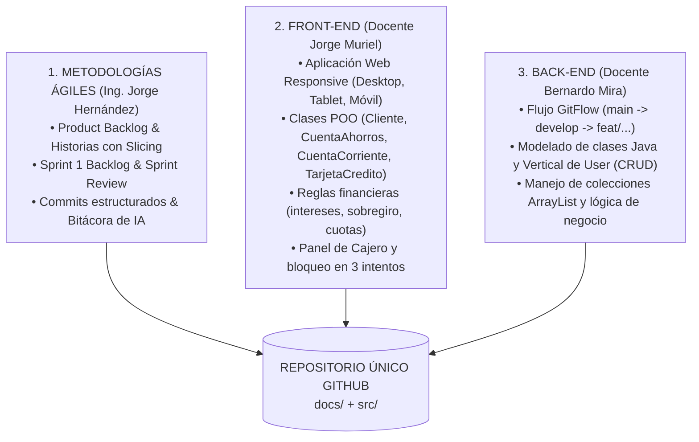

# PLAN MAESTRO INTEGRADOR: SISTEMA BANCARIO "MI PLATA"

> **Estrategia de Entrega Única para Momento 2**  
> **Materias:** Front-end I · Back-end (Java) · Metodologías Ágiles (Scrum)  
> **Institución:** CESDE – Desarrollo de Software

---

## 1. Visión General del Proyecto Integrador
El proyecto consiste en el desarrollo y documentación del sistema bancario y cajero automático **"Mi Plata"**. Este desarrollo unifica los criterios de evaluación de los tres docentes en un único repositorio de GitHub, garantizando el cumplimiento estricto de cada rúbrica sin duplicar esfuerzos.



---

## 2. Mapa de Requerimientos por Materia

### A. Front-end (Docente: Jorge Albeiro Muriel)
| Requerimiento | Criterio de Cumplimiento en "Mi Plata" |
| :--- | :--- |
| **POO en JS (30%)** | Clases: `Cliente`, `Cuenta` (base), `CuentaAhorros`, `CuentaCorriente`, `TarjetaCredito`. Polimorfismo en `calcularRetiro()`. |
| **Reglas Financieras (30%)** | Rendimiento 1.5% en Ahorros; Sobregiro 20% en Corriente; Amortización mensual para Tarjeta de Crédito según cuotas ($\le 2$ al 0%, 3-6 al 1.9%, $\ge 7$ al 2.3%). |
| **Seguridad y CRUD (10%)** | Formulario con validaciones, bloqueo al tercer intento fallido con aviso y contador visible, CRUD de usuarios. |
| **Diseño Responsive (30%)** | Maquetación adaptable a 1920px (Desktop), 786px (Tablet) y 460px (Smartphone). Vistas: Landing, Registro/Login, Panel Cajero. |

### B. Back-end (Docente: Bernardo Alonso Mira)
| Requerimiento | Criterio de Cumplimiento en "Mi Plata" |
| :--- | :--- |
| **Flujo Git / GitFlow** | Rama `develop` obligatoria como integradora; ramas de trabajo por historia (`feat/hu01-user-crud`, `feat/ms01`). Cero commits directos a `main`. |
| **Vertical de Usuario (CRUD)** | Clase base `Person` heredada por `User` / `Cliente`. Métodos obligatorios: `updateUser()`, `selectUserById()`, `deleteUser()`, `countUsers()`. |
| **POO y Colecciones** | Encapsulamiento con modificadores privados, getters/setters, almacenamiento en `ArrayList<User>`, ejecución interactiva en `menuUser()`. |

### C. Metodologías Ágiles (Docente: Ing. Jorge Eliécer Hernández)
| Requerimiento | Criterio de Cumplimiento en "Mi Plata" |
| :--- | :--- |
| **Estructura en GitHub** | Documentación viva en `.md` dentro de `docs/` (`product-backlog.md`, `user-stories.md`, `docs/sprints/sprint-01/`). |
| **Descomposición (Slicing)** | Épica $\to$ Features $\to$ Historias de Usuario con formato *"Como [rol], quiero [acción] para [beneficio]"*, Criterios de Aceptación (CA) y Story Points. |
| **Commits Estructurados** | Uso estricto de Conventional Commits (`chore:`, `docs:`, `feat:`, `fix:`). |
| **Competencia en IA (25%)** | Bitácora de uso de IA con prompt utilizado, propuesta de la IA y justificación de ajustes propios para la sustentación oral de 2 min. |

---

## 3. Estructura Oficial del Repositorio

El repositorio cumplirá la convención solicitada en el manual de Scrum + GitHub:

```text
mi-plata-banco/
├── README.md                      <- Portada: Visión del producto, equipo, tecnologías, link a docs
├── .gitignore                     <- Exclusión de node_modules, .class, .idea, etc.
├── docs/
│   ├── product-backlog.md         <- Backlog permanente priorizado (Épicas, Features, US, Puntos)
│   ├── user-stories.md            <- Historias de usuario detalladas con Criterios de Aceptación (CA)
│   ├── ia-bitacora.md             <- Registro de prompts, sugerencias y adaptaciones críticas (Evaluación IA)
│   └── sprints/
│       └── sprint-01/
│           ├── sprint-backlog.md  <- Tareas e historias del Sprint 1 (con checklist de tareas)
│           └── sprint-review.md   <- Cierre del Sprint 1: qué se completó, qué no y evidencias
└── src/
    ├── frontend/                  <- Aplicación Web del Cajero "Mi Plata" (HTML5, CSS3, JS POO)
    │   ├── index.html             <- Landing Page
    │   ├── login.html             <- Vistas de acceso y registro con contador de intentos
    │   ├── cajero.html            <- Panel de transacciones bancarias
    │   ├── css/
    │   │   └── styles.css         <- Estilos responsivos (1920px, 786px, 460px)
    │   └── js/
    │       ├── models/            <- Clases Cliente, Cuenta, CuentaAhorros, CuentaCorriente, TarjetaCredito
    │       └── app.js             <- Lógica del DOM, eventos y transacciones
    └── backend-java/              <- Implementación Java de la Vertical de Usuario y Cuentas
        └── src/
            ├── models/            <- Person.java, User.java, Admin.java
            ├── services/          <- UserService.java (CRUD y conteo sobre ArrayList)
            └── Main.java          <- menuUser() interactivo por consola
```

---

## 4. Desglose del Product Backlog (Épicas y Features de "Mi Plata")

### ÉPICA 1: Autenticación, Seguridad y Gestión de Clientes
- **Feature 1.1: Registro de Clientes**
  - `US-01`: Registro de nuevo cliente con identificación, nombre, celular, username único y password. *(5 pts)*
- **Feature 1.2: Acceso Seguro**
  - `US-02`: Inicio de sesión con validación de credenciales y bloqueo preventivo tras 3 intentos fallidos. *(3 pts)*
- **Feature 1.3: Administración de Usuarios (Vertical User)**
  - `US-03`: Mantenimiento y CRUD de usuarios (`updateUser`, `selectById`, `deleteUser`, `countUsers`). *(5 pts)*

### ÉPICA 2: Módulo de Transacciones del Cajero
- **Feature 2.1: Gestión de Saldo y Fondos**
  - `US-04`: Consulta de saldo y consignación con validación de valor positivo. *(3 pts)*
  - `US-05`: Retiro con polimorfismo (interés 1.5% en Ahorros y sobregiro 20% en Corriente). *(8 pts)*
- **Feature 2.2: Transferencias y Movimientos**
  - `US-06`: Transferencias entre cuentas del mismo usuario o a terceros. *(5 pts)*
  - `US-07`: Bitácora de historial de movimientos ordenada cronológicamente descendente. *(5 pts)*

### ÉPICA 3: Módulo de Tarjeta de Crédito
- **Feature 3.1: Financiamiento a Cuotas**
  - `US-08`: Simulación y compra a cuotas aplicando fórmula amortizada según plazo. *(5 pts)*

---

## 5. Plan de Ejecución para el Sprint 1 (Entregable Próxima Semana)

* **Objetivo del Sprint 1 (Sprint Goal):**  
  *Implementar la infraestructura del repositorio, la documentación ágil en Markdown, la vertical de usuario/autenticación con bloqueo de intentos y la maqueta visual responsive del banco.*

### Historias Seleccionadas para el Sprint 1:
1. **US-01: Registro de Clientes.**
2. **US-02: Inicio de Sesión con Control de Intentos.**
3. **US-03: Vertical de Usuarios (CRUD en Java & JS).**

### Desglose de Tareas Técnicas (Técnicas de Slicing):
- [ ] **Tarea 1 (Scrum/GitHub):** Crear repo, configurar `.gitignore`, `README.md` y estructura de carpetas en `docs/`.
- [ ] **Tarea 2 (Scrum):** Redactar `product-backlog.md`, `user-stories.md` y `sprint-backlog.md` del Sprint 1.
- [ ] **Tarea 3 (Scrum/IA):** Documentar la bitácora de uso crítico de IA (`ia-bitacora.md`).
- [ ] **Tarea 4 (Front-end):** Maquetar Landing Page, Login y Registro con CSS responsive (Desktop/Tablet/Móvil).
- [ ] **Tarea 5 (Front-end):** Implementar clases POO (`Cliente`, `Cuenta`, `CuentaAhorros`, `CuentaCorriente`, `TarjetaCredito`) en JS.
- [ ] **Tarea 6 (Front-end):** Lógica de login con bloqueo a 3 intentos y mensaje informativo.
- [ ] **Tarea 7 (Back-end):** Implementar clases Java (`Person`, `User`, `Admin`), métodos CRUD (`updateUser`, `selectUserById`, `deleteUser`, `countUsers`) y `menuUser()`.
- [ ] **Tarea 8 (GitFlow):** Realizar commits y merges ordenados (`develop` $\leftarrow$ `feat/hu...`).

---

## 6. Secuencia Recomendada de Commits (Sprint 1)
1. `chore: initialize repository structure and gitignore`
2. `docs: add README with project vision and team roles`
3. `docs: add product backlog and user stories with acceptance criteria`
4. `docs: setup sprint 1 backlog and AI usage log`
5. `feat: create base HTML layout and responsive CSS styles`
6. `feat: implement OOP classes for Client and Accounts in JS`
7. `feat: implement login validation with 3 attempts lockout`
8. `feat: implement Java Person and User classes with CRUD operations`
9. `test: verify Java menuUser execution and DOM interactions`
10. `docs: complete sprint 1 review and evidence documentation`

---

## 7. Preparación para Sustentaciones Orales
- **Con el profesor de Front-end:** Demostración en vivo de la página web (F12 para probar responsive en 1920px, 786px y 460px), simulación de los 3 intentos fallidos de login, y muestra de las clases de herencia/polimorfismo en el código JS.
- **Con el profesor de Back-end:** Mostrar el historial de ramas en GitHub (`git log --graph` o la pestaña Insights de GitHub demostrando el uso de `develop` y ramas `feat/`), y ejecución en consola de `menuUser()` en Java probando el CRUD de usuarios.
- **Con el profesor de Metodologías Ágiles:** Presentar la carpeta `docs/` en GitHub con el Product Backlog y Sprint 1, y sustentar en 2 minutos la priorización de épicas y cómo se ajustaron las sugerencias de la IA con criterio propio.
