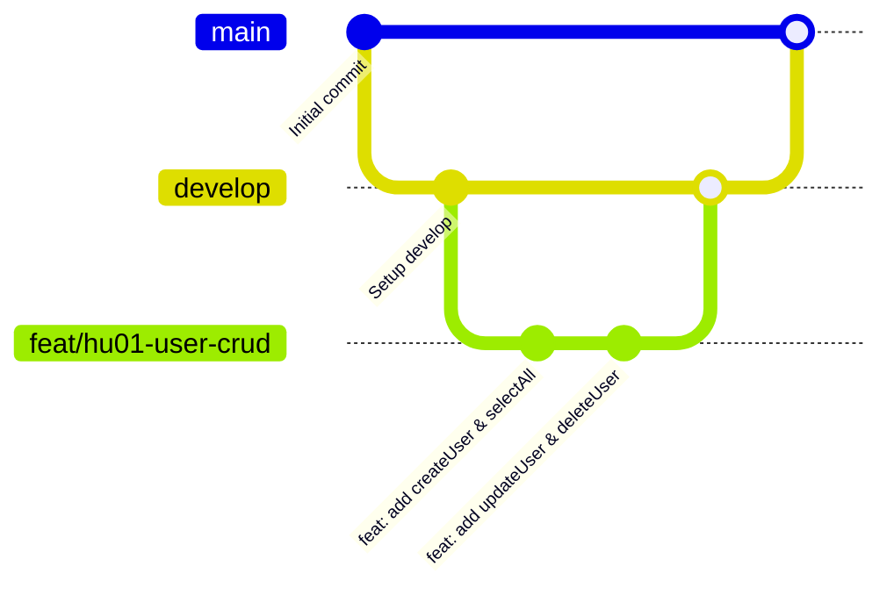

# Requerimientos y Documentación: Back-end (Java)

**Institución:** CESDE  
**Programa:** Desarrollo de Software  
**Docente:** Bernardo Alonso Mira García  
**Lenguaje y Entorno:** Java (JDK), Git & GitHub, Android Studio / IDE Java (IntelliJ / NetBeans / VS Code)  
**Momento Evaluativo:** Momento 2 (POO, Colecciones, GitFlow, Arquitectura)

---

## 1. ¿Qué pide exactamente el profesor de Back-end?

El docente evalúa tres componentes fundamentales:
1. **Flujo de Trabajo Profesional con Git y GitHub (GitFlow):**
   - No se hace commit directo a `main`.
   - Estructura de ramas:
     - `main`: Código final y estable.
     - `develop`: Rama principal de integración y desarrollo.
     - Ramas de funcionalidades o Historias de Usuario: ramas secundarias creadas desde `develop` con el formato `feat/<identificador>` (ejemplo: `feat/ms01` o `feat/hu01-user-crud`).
   - Los commits deben reflejar el avance incremental de cada historia de usuario.
2. **Programación Orientada a Objetos en Java (POO) & Arquitectura:**
   - Clases, Herencia (`extends`), Interfaces (`implements`), Encapsulamiento (`private`, getters y setters).
   - Polimorfismo y sobreescritura (`@Override`).
   - Colecciones en memoria (`ArrayList`) o persistencia con JPA/Hibernate.
3. **Desarrollo por "Verticales" (Vertical Slices):**
   - Una "vertical" es la implementación completa de un módulo o entidad de principio a fin (Modelo $\to$ Lógica/CRUD $\to$ Menú o Interfaz).

---

## 2. Evidencia de Desempeño 1 - Momento 2 (Referencia de Clase: "Ticket Max")

En clase se trabajó el proyecto base **Ticket Max** (diagrama UML de eventos, boletos y usuarios). La evidencia exige:

### 2.1 Métodos a Implementar en la vertical `User`:
- `updateUser()`: Modificar datos de un usuario existente.
- `selectUserById()`: Buscar y obtener un usuario por su identificador.
- `deleteUser()`: Eliminar un usuario del sistema.
- `countUsers()` *(Método adicional solicitado)*: Consultar el total de usuarios registrados en el `ArrayList`.

### 2.2 Requisitos de Prueba y Entrega:
- Integrar y probar los métodos en `menuUser()`.
- Documento con:
  - Enlace al repositorio de GitHub.
  - Capturas de la implementación del código.
  - Capturas de la ejecución en consola mostrando el funcionamiento de cada método.

---

## 3. Modelo de Clases (Diagrama UML)
El docente presentó la estructura base de clases:
- **`Person` (Clase base):**
  - Atributos: `id`, `name`, `lastName`, `email`, `phone`, `password`, `state`.
  - Métodos: `create()`, `selectAll()`, `selectById(int id)`, `update()`, `deleteById(int id)`, `selectState(int id)`.
- **`User` (Hereda de `Person`):**
  - Atributos propios: `city`, `preferences`.
- **`Admin` (Hereda de `Person`):**
  - Atributos propios: `rol`, `area`.

---

## 4. Estrategia de Ramas Git (GitFlow)

- **Nombre de ramas:** `feat/ms01` o `feat/hu-user`
- **Commits descriptivos:** basados en la tarea o historia de usuario realizada.
