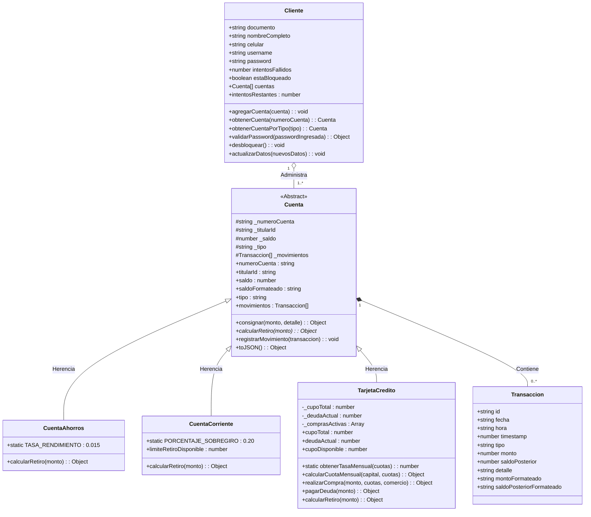
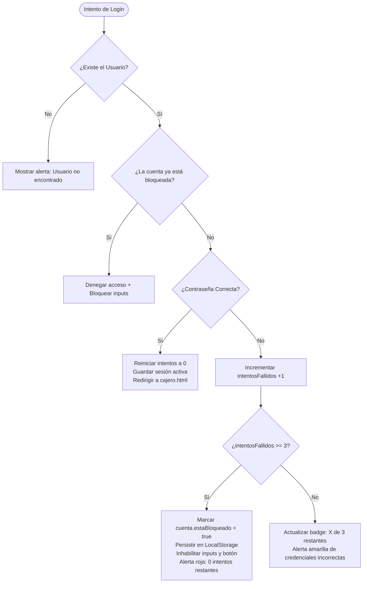

# ARQUITECTURA Y DOCUMENTACIÓN TÉCNICA: FRONT-END "MI PLATA"

> **Institución:** CESDE – Desarrollo de Software  
> **Materia:** Front-end I (Momento 2: POO, DOM, Estructuras de Datos y Responsive Web)  
> **Docente:** Jorge Albeiro Muriel Vélez  
> **Proyecto:** Sistema Bancario y Cajero Inteligente "Mi Plata"  
> **Ubicación del Código:** `src/frontend/`

---

## 1. Visión General del Sistema Web

La aplicación web del banco **"Mi Plata"** es una solución bancaria de una sola página y multi-vista desarrollada estrictamente con **JavaScript Nativo (ES6+)**, **HTML5 Semántico** y **CSS3 Puro**, sin dependencias de frameworks externos (React, Angular o Vue), cumpliendo a cabalidad los requisitos del docente.

### 1.1 Estructura del Código Fuente
```text
src/frontend/
├── index.html                      # Landing Page institucional y simulador de productos
├── login.html                      # Portal de acceso, registro y control de 3 intentos
├── cajero.html                     # Panel del Cajero Automático y banca transaccional
├── test_runner.js                  # Suite de pruebas automatizadas de reglas financieras y POO
├── css/
│   └── styles.css                  # Hoja de estilos responsive (1920px, 786px y 460px)
├── js/
│   ├── models/
│   │   ├── Transaccion.js          # Inmutabilidad y bitácora de movimientos
│   │   ├── Cuenta.js               # Clase base abstracta con encapsulamiento
│   │   ├── CuentaAhorros.js        # Herencia + Rendimiento 1.5% al retiro
│   │   ├── CuentaCorriente.js      # Herencia + Sobregiro del 20%
│   │   ├── TarjetaCredito.js       # Herencia + Amortización de cuotas
│   │   └── Cliente.js              # Entidad titular, seguridad y portafolio de cuentas
│   ├── services/
│   │   └── StorageService.js       # Persistencia en LocalStorage y sesiones
│   ├── auth.js                     # Controlador de Login, Registro y bloqueo por fuerza bruta
│   ├── cajero.js                   # Controlador de transacciones del cajero y CRUD de perfil
│   └── landing.js                  # Controlador del simulador de crédito en la portada
```

---

## 2. Paradigma Obligatorio: Programación Orientada a Objetos (POO)

### 2.1 Diagrama de Clases UML


### 2.2 Pilares de POO Demostrados en el Código

1. **Abstracción:**  
   - `Cuenta.js` define el contrato y atributos comunes (`_numeroCuenta`, `_saldo`, `_titularId`, `_movimientos`), impidiendo su instanciación directa (`new.target === Cuenta`).

2. **Encapsulamiento:**  
   - Los atributos críticos usan prefijo protegido `_` y se acceden exclusivamente mediante *getters* y métodos validadores (`saldo`, `saldoFormateado`, `cupoDisponible`, `intentosRestantes`), protegiendo el estado de manipulaciones indebidas.

3. **Herencia:**  
   - Las clases `CuentaAhorros`, `CuentaCorriente` y `TarjetaCredito` extienden con `extends Cuenta` y llaman al constructor padre con `super()`, reutilizando la lógica base de consignaciones, historial y serialización.

4. **Polimorfismo:**  
   - El método `calcularRetiro(monto)` se comporta de tres formas completamente diferentes según la clase concreta:
     - En **`CuentaAhorros`**: Aplica un rendimiento del **1.5%** sobre el retiro y prohíbe exceder el saldo disponible.
     - En **`CuentaCorriente`**: Permite sobregiro hasta de un **20%** sobre el saldo actual, permitiendo saldo negativo controlado.
     - En **`TarjetaCredito`**: Lo procesa como un **avance en efectivo** a 12 cuotas amortizadas consumiendo el cupo disponible.

---

## 3. Justificación de Reglas Financieras y Fórmulas Matemáticas

### 3.1 Cuenta de Ahorros: Rendimiento del 1.5% al Retiro
- **Regla:** Premia el ahorro acreditando un 1.5% sobre el dinero que el cliente retira.
- **Fórmula:**
  $$\text{Rendimiento} = \text{Monto Retirado} \times 0.015$$
  $$\text{Saldo Final} = \text{Saldo Actual} + \text{Rendimiento} - \text{Monto Retirado}$$
- **Ejemplo en Código:**
  - Saldo actual: `$1.000.000`
  - Retiro: `$200.000`
  - Rendimiento: `$200.000 \times 0.015 = $3.000`
  - Saldo resultante: `$1.000.000 + $3.000 - $200.000 = $803.000`

### 3.2 Cuenta Corriente: Sobregiro del 20%
- **Regla:** El cliente puede girar o retirar hasta un 20% más del saldo positivo disponible.
- **Fórmula:**
  $$\text{Límite Máximo de Retiro} = \text{Saldo Actual} \times 1.20$$
- **Ejemplo en Código:**
  - Saldo actual: `$1.000.000`
  - Límite de retiro autorizado: `$1.200.000`
  - Si retira `$1.150.000`, el banco autoriza la operación y el saldo resultante queda en `-$150.000` (utilizó `$150.000` del cupo de sobregiro).

### 3.3 Tarjeta de Crédito: Fórmula de Amortización Francesa
- **Tabla de Tasas según Plazo:**
  - $\le 2$ cuotas: **0% de interés** mensual ($i = 0$).
  - $3 - 6$ cuotas: **1.9% mensual** ($i = 0.019$).
  - $\ge 7$ cuotas: **2.3% mensual** ($i = 0.023$).
- **Fórmula de la Cuota Fija Mensual ($A$):**
  - Si $i = 0$:
    $$A = \frac{\text{Capital}}{n}$$
  - Si $i > 0$:
    $$A = \frac{P \times i}{1 - (1 + i)^{-n}}$$
    *(Donde $P$ = Capital financiado, $i$ = Tasa mensual en decimal, $n$ = Número de cuotas)*.
- **Ejemplo en Código (Compra de \$1.200.000 a 6 cuotas):**
  - $P = 1.200.000$, $i = 0.019$, $n = 6$.
  - Numerador: $1.200.000 \times 0.019 = 22.800$
  - Denominador: $1 - (1 + 0.019)^{-6} = 1 - 0.89323 = 0.106769$
  - Cuota mensual: $\frac{22.800}{0.106769} \approx \mathbf{\$213.545\text{ COP}}$
  - Total a pagar: $\$213.545 \times 6 = \$1.281.270$ (Intereses: $\$81.270$).

---

## 4. Módulo de Seguridad: Bloqueo tras 3 Intentos Fallidos

### 4.1 Flujo de Autenticación y Bloqueo


### 4.2 Indicador Visual en la UI
- La interfaz presenta un componente interactivo:
  ```html
  <div class="attempts-counter-box">
      <span>Intentos de acceso restantes:</span>
      <span class="attempts-badge safe" id="badge-intentos">3 de 3</span>
  </div>
  ```
- Al fallar el 1er intento: pasa a **2 de 3** (color amarillo / warning).
- Al fallar el 2do intento: pasa a **1 de 3** (color amarillo / warning).
- Al fallar el 3er intento: pasa a **0 de 3** (color rojo / danger), se desactivan los controles de texto (`disabled = true`) y se muestra la alerta permanente de bloqueo.

---

## 5. Diseño Responsive y Adaptabilidad Multi-Dispositivo

El diseño fue concebido con enfoque *Mobile-First* y refinado para cumplir estrictamente con los tres puntos de inspección requeridos:

| Breakpoint | Dispositivo Objetivo | Adaptaciones de Interfaz |
| :--- | :--- | :--- |
| **460px** | Smartphone / Teléfono Móvil | Cabecera verticalizada, menú accesible, tarjetas bancarias apiladas en columna única (`1fr`), botones de ancho completo (touch-targets ergonómicos de 48px), tablas con scroll horizontal nativo (`overflow-x: auto`). |
| **786px** | Tablet (iPad / Vista Vertical) | Grid de productos a dos columnas (`repeat(2, 1fr)`), panel de bienvenida en dos columnas, formularios compactos y tarjetas bancarias en cuadrícula. |
| **1920px** | Desktop Full HD / Ultra-Wide | Ancho de contenedor extendido a `1600px`, escala tipográfica base ajustada a `17px`, cuadrícula de 3 columnas para productos y cuentas, panel de operaciones y tabla transaccional en disposición *Side-by-Side* (`420px 1fr`). |

---

## 6. Guía Rápida para la Sustentación Oral (Docente Jorge Muriel)

Para obtener la calificación máxima (5.0 / 5.0), sigue estos pasos durante la sustentación:

1. **Demostración de Responsive (F12 en el Navegador):**
   - Abre `index.html` o `cajero.html`.
   - Presiona `F12` y activa la barra de dispositivos móviles (`Ctrl + Shift + M`).
   - Ajusta el ancho a **460px**: Muestra cómo el menú y las tarjetas se apilan perfectamente sin desbordes horizontales.
   - Ajusta el ancho a **786px**: Muestra la distribución en 2 columnas para tablet.
   - Ajusta el ancho a **1920px**: Muestra el diseño expandido para pantallas de escritorio amplias.

2. **Demostración de Seguridad (Bloqueo a 3 Intentos):**
   - Ve a `login.html`.
   - Ingresa el usuario demo: `carlos99`.
   - Escribe una contraseña incorrecta y presiona "Ingresar". Observa el cambio a *"2 de 3"*.
   - Falla una segunda vez: Observa el cambio a *"1 de 3"*.
   - Falla la tercera vez: Observa el bloqueo inmediato de los inputs de texto, el botón deshabilitado y la alerta de bloqueo preventivo.
   - Presiona el botón *"Restablecer Intentos / Desbloquear Demo"* para continuar.

3. **Demostración de Polimorfismo en el Cajero (`cajero.html`):**
   - Inicia sesión con `carlos99` / `Pass123!`.
   - **Prueba 1 (Cuenta Ahorros):** Selecciona la Cuenta de Ahorros. Retira `$100.000`. Muestra en la alerta y en la tabla de movimientos cómo se calculó y abonó el **1.5% de rendimiento ($1.500 COP)**.
   - **Prueba 2 (Cuenta Corriente):** Selecciona la Cuenta Corriente. Realiza un retiro que supere el saldo positivo (dentro del 20% de sobregiro). Muestra cómo el sistema autoriza la operación y deja el saldo en negativo con aviso de sobregiro.
   - **Prueba 3 (Tarjeta de Crédito):** Selecciona la Tarjeta de Crédito. Simula o ejecuta una compra diferida a 6 cuotas. Muestra cómo se aplica la tasa del 1.9% mensual y la cuota fija mediante la fórmula francesa.

4. **Verificación de Pruebas Unitarias Automatizadas:**
   - Abre la consola y ejecuta:
     ```powershell
     node src/frontend/test_runner.js
     ```
   - Muestra las **23 pruebas pasadas al 100%**, confirmando la solidez matemática y de POO.
